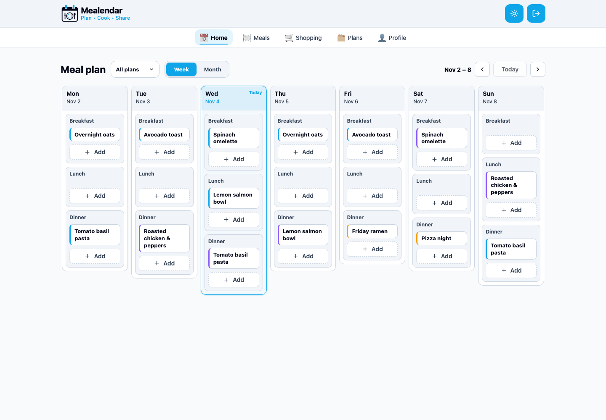

# Meal Planner

Meal Planner is a full-stack application for organizing recipes, personal and shared
calendars, and shopping lists in one connected workflow.

**Status:** Work in progress. The core MVP is functional and continues to evolve.

## Live Showcase

Explore the static product showcase on
[GitHub Pages](https://amorymeow.github.io/meal_planner/). It contains the landing
page and real, theme-aware application screenshots. The showcase is frontend-only and
does not connect to the Django API.

<picture>
  <source
    media="(prefers-color-scheme: dark)"
    srcset="./frontend/public/landing/weekly-plan-dark.png"
  />
  
</picture>

## Features

- **Authentication:** registration, sign-in, sign-out, automatic access-token refresh,
  and an HTTP-only refresh-token cookie with a seven-day lifetime.
- **Meals:** create and edit meals with a source, serving yield, instructions, tags,
  and reusable ingredients with quantities and units.
- **Meal sharing:** keep meals private or share them with selected groups using read or
  edit access.
- **Meal plans:** personal and group calendars with week and month views, configurable
  meal sections, multiple meals per slot, notes, servings, and drag-and-drop.
- **Groups:** create groups, invite participants by email, accept or revoke invitations,
  manage members, and protect owner-only settings on the backend.
- **Shopping lists:** calculate and combine current recipe ingredients for selected
  plans and date ranges.
- **Responsive UI:** desktop and mobile layouts, keyboard focus states, reusable UI
  components, and light and dark themes.
- **Administration and API:** Django admin, protected REST endpoints, permission-scoped
  querysets, and Swagger documentation.

## Roadmap

- Add the profile settings interface for the existing `/api/me/` endpoint.
- Archive meals while preserving calendar history.
- Persist calendar filters and view preferences.
- Build **Meal Poker**: private ranked voting that helps a group choose a meal and add
  the winner to its plan.
- Deploy the complete Django and PostgreSQL application as an interactive demo.

## Tech Stack

### Frontend

- React and TypeScript
- Vite
- React Router
- TanStack Query
- Emotion
- dnd-kit

### Backend

- Django and Django REST Framework
- Simple JWT
- PostgreSQL
- drf-spectacular
- Gunicorn

### Infrastructure

- Docker and Docker Compose
- Nginx
- GitHub Actions and GitHub Pages

## Architecture

The backend is a Django monolith split into domain applications. Each application owns
its models, serializers, views, permissions, services, migrations, and tests. API
querysets are restricted to resources available to the current user; the frontend is
not treated as a security boundary.

The frontend is organized by product feature. TanStack Query owns server state, while
React state and Context are used for local UI and authentication state. Access tokens
stay in memory, and the refresh token is stored in an HTTP-only cookie.

```text
meal_planner/
├── backend/
│   ├── accounts/             # Users, authentication, and profile API
│   ├── groups/               # Groups, memberships, and invitations
│   ├── meals/                # Meals, tags, ingredients, and sharing
│   ├── planning/             # Personal/group plans and calendar items
│   ├── shopping/             # Generated shopping lists
│   └── meal_planner_backend/ # Django configuration and root URLs
├── frontend/
│   ├── public/landing/       # Theme-aware showcase screenshots
│   ├── scripts/              # Reproducible screenshot capture
│   └── src/
│       ├── app/              # Application shell and landing page
│       ├── auth/
│       ├── groups/
│       ├── meals/
│       ├── plan/             # Calendar screen
│       ├── plans/            # Plan and group settings
│       ├── shopping/
│       └── ui/               # Reusable UI components and design tokens
├── docker/                   # Compose, Nginx, and environment configuration
└── .github/workflows/        # GitHub Pages deployment
```

## Quick Start

### Requirements

- Docker with Docker Compose
- Git

### Run the application

1. Clone the repository:

   ```bash
   git clone https://github.com/AmoryMeow/meal_planner.git
   cd meal_planner
   ```

2. Create the local environment file and replace the example secrets:

   ```bash
   cp docker/.env.example docker/.env
   ```

3. Build and start the services:

   ```bash
   docker compose -f docker/docker-compose.yml up -d --build
   ```

4. Apply database migrations:

   ```bash
   docker compose -f docker/docker-compose.yml exec backend \
     python manage.py migrate
   ```

5. Optionally create an administrator:

   ```bash
   docker compose -f docker/docker-compose.yml exec backend \
     python manage.py createsuperuser
   ```

### Local URLs

- Application: [http://localhost](http://localhost)
- Django API: [http://localhost/api/](http://localhost/api/)
- Django admin: [http://localhost/admin/](http://localhost/admin/)
- Swagger UI: [http://localhost/api/doc/](http://localhost/api/doc/) — staff access
  required
- PostgreSQL: `localhost:5432`

## Environment Variables

The application reads its local configuration from `docker/.env`:

```env
DB_NAME=meal_planner
DB_USER=postgres
DB_PASSWORD=change-me
DB_HOST=postgres
DB_PORT=5432

SECRET_KEY=replace-with-a-random-secret
DEBUG=False
ALLOWED_HOSTS=localhost,127.0.0.1,backend,nginx
AUTH_REFRESH_COOKIE_SECURE=False

FRONTEND_URL=http://localhost
EMAIL_BACKEND=django.core.mail.backends.console.EmailBackend
DEFAULT_FROM_EMAIL=Mealendar <noreply@localhost>
```

`SECRET_KEY` is required and has no source-code fallback. `DEBUG` defaults to `False`.
Use `AUTH_REFRESH_COOKIE_SECURE=True` behind HTTPS.

The console email backend prints local group invitations to the backend logs:

```bash
docker compose -f docker/docker-compose.yml logs -f backend
```

For production delivery, configure Django's SMTP email backend and the `EMAIL_HOST`,
`EMAIL_PORT`, `EMAIL_HOST_USER`, `EMAIL_HOST_PASSWORD`, and `EMAIL_USE_TLS` variables.

## Development and Quality Checks

### Backend

```bash
cd backend
python3 -m venv venv_local
source venv_local/bin/activate
pip install -r requirements.txt

ruff check .
ruff format --check .
python manage.py test
```

The local backend requires the database and environment variables from
`docker/.env`. Tests can also be run inside the configured container:

```bash
docker compose -f docker/docker-compose.yml exec backend python manage.py test
```

### Frontend

```bash
cd frontend
yarn install --frozen-lockfile

yarn lint
yarn format:check
yarn build
```

To run Vite directly during frontend development:

```bash
yarn dev
```

## Reproducible Showcase Screenshots

The landing page uses reproducible demo data and screenshots of the real application.
This workflow is restricted to local development unless `--force` is explicitly used.

1. Set `DEMO_USER_PASSWORD` in `docker/.env`, rebuild the backend, and seed the data:

   ```bash
   docker compose -f docker/docker-compose.yml up -d --build backend
   docker compose -f docker/docker-compose.yml exec backend \
     python manage.py seed_demo_data --force
   ```

2. Export the same password and capture both themes:

   ```bash
   cd frontend
   export DEMO_USER_PASSWORD=your-local-demo-password
   yarn capture:landing
   ```

The capture script uses the `en-US` locale and writes light and dark desktop/mobile
images to `frontend/public/landing/`. Running the seed command again safely recreates
the same demo users and content for the current week.

## API Documentation

The REST API is available below `/api/`. Interactive Swagger documentation is served
at `/api/doc/` and requires a staff user. Create one with:

```bash
docker compose -f docker/docker-compose.yml exec backend \
  python manage.py createsuperuser
```

The versioned OpenAPI contract is stored in `backend/openapi.yml`. After changing API
serializers, views, or routes, regenerate and validate it from the repository root
with the backend virtual environment activated:

```bash
make api-schema
```

To update both the backend contract and the generated frontend types, run:

```bash
make api-types
```

Generated types are written to `frontend/src/api/generated/schema.ts` and should not
be edited manually.

## Deployment

The static landing-page showcase is built from `main` by GitHub Actions and published
to GitHub Pages. It intentionally excludes authentication and API calls.

The complete application requires a Django runtime, PostgreSQL, and secure production
configuration; it is currently intended to run locally through Docker Compose.
